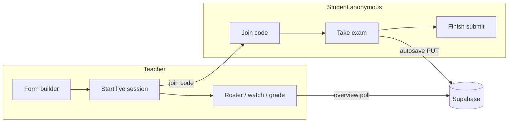
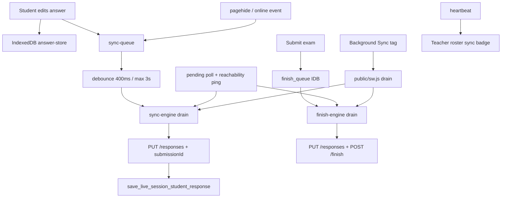

# TruePaper — Feature & Architecture Guide

**Audience:** AI agents and developers working in this repo.  
**Goal:** Fast orientation — what the product does, how flows connect, and where code lives.

> **Maintenance:** When you add, remove, or materially change a feature, API route, migration, env var, or major module, update **this file in the same PR/commit**. See [Keeping this doc current](#keeping-this-doc-current).

---

## Table of contents

1. [Product summary](#product-summary)
2. [Stack & repo layout](#stack--repo-layout)
3. [Auth & identity](#auth--identity)
4. [Teacher features](#teacher-features)
5. [Student features](#student-features)
6. [Live sessions (runtime)](#live-sessions-runtime)
7. [Offline sync & PWA](#offline-sync--pwa)
8. [Question & response types](#question--response-types)
9. [Grading & review](#grading--review)
10. [Template library](#template-library)
11. [i18n, legal, chrome](#i18n-legal-chrome)
12. [Typography](#typography)
13. [List UI (entity lists)](#list-ui-entity-lists)
14. [Database & migrations](#database--migrations)
15. [API routes](#api-routes)
16. [Key files map](#key-files-map)
17. [Client runtime (hooks, polling, broadcast)](#client-runtime-hooks-polling-broadcast)
18. [Testing](#testing)
19. [Environment variables](#environment-variables)
20. [Deployment notes](#deployment-notes)
21. [Agent conventions & pitfalls](#agent-conventions--pitfalls)
22. [Keeping this doc current](#keeping-this-doc-current)

---

## Product summary

**TruePaper** is a classroom form/exam platform for teachers and anonymous students.

| Role | Auth | Primary UI |
|------|------|------------|
| **Teacher** | Supabase email/password or Google OAuth | `app/[lang]/dashboard/`, builder in `HomeClient.tsx` |
| **Student** | None — browser `deviceId` (UUID in `localStorage`) | `app/[lang]/join/`, exam in `HomeClient.tsx` |

Core loop:

1. Teacher builds a form (questions of many types).
2. Teacher starts a **live session** → 6-character **join code** + time window.
3. Students join with code + display name, answer questions with autosave.
4. Teacher monitors roster, gives live feedback, suspends tab-leavers, grades.
5. Student submits (finish) → teacher grades → optional review share link / PDF.



---

## Stack & repo layout

| Path | Purpose |
|------|---------|
| `app/[lang]/` | Localized pages (en, uk) |
| `app/api/` | Next.js Route Handlers (teacher auth + public student APIs) |
| `app/auth/callback/` | OAuth code exchange |
| `components/` | Shared React UI |
| `lib/` | Domain logic, Supabase clients, offline sync, i18n |
| `messages/` | `en.json`, `uk.json` translation dictionaries |
| `public/` | Static assets, `manifest.json`, `sw.js` (service worker) |
| `supabase/migrations/` | Ordered SQL migrations (source of truth for schema) |
| `supabase/schema.sql` | Greenfield bootstrap (alternative to migrations) |
| `e2e/` | Playwright functional tests |
| `load-tests/` | k6 load test for student sync |
| `proxy.ts` | Locale routing, teacher home → dashboard redirect, Supabase session refresh |
| `docs/FEATURES.md` | **This file** |

**Framework notes:** Next.js **16** (App Router), React **19**. Read `node_modules/next/dist/docs/` before assuming Next APIs — this project uses Next 16 conventions (`AGENTS.md`).

---

## Auth & identity

### Teachers

- Cookie session via `@supabase/ssr` — `lib/supabase/server.ts`, refreshed in `proxy.ts`.
- **Static home/join:** `app/[lang]/page.tsx` and `app/[lang]/join/page.tsx` are statically generated; guests skip server auth. Signed-in users hydrate via `GET /api/auth/session` in `lib/use-client-session-hydration.ts` (only when a Supabase auth cookie is present).
- **Teacher home redirect:** `proxy.ts` sends teachers from plain `/[lang]` to `/[lang]/dashboard` before RSC (skips loading `HomeClient` for the common case). Builder (`?form=`) and join query params bypass the redirect — `lib/home-url-intent.ts` → `hasTeacherHomeIntentFromSearchParams`.
- `profiles` table: `role` is `'teacher'` or `'student'`; OAuth signups default to teacher (`20260524100000_oauth_signup_defaults.sql`); `avatar_url` + `teacher_defaults` come from `20261023130000_teacher_settings.sql` (see [Settings](#settings-dashboardsettings)).
- API routes use `getSessionUser()` from `lib/request-auth.ts`.
- RLS: teachers own `forms` / `questions`; session owner manages live session data.

### Students (anonymous)

- **No login.** UUID v4 stored as `truepaper_anonymous_session_id` in `localStorage` — `lib/anonymous-session.ts`.
- All student writes go through **anon key** + **SECURITY DEFINER RPCs** — `lib/supabase/anon-service.ts`. **No service role key** in the app.
- Display name required (1–120 chars) — `lib/live-session-display-name.ts`.
- **Resume code** (8-char, teacher-issued) re-binds a lost device to the same `deviceId` — `lib/resume-code.ts`.

---

## Teacher features

### Registration & login

- Pages: `app/[lang]/register/page.tsx`, `app/[lang]/login/page.tsx`
- APIs: `POST /api/auth/register`, `login`, `logout`; `GET /api/auth/session`
- Password policy: `lib/password-policy.ts`
- Google OAuth: `components/GoogleSignInButton.tsx` → `/auth/callback`

### Dashboard

- `app/[lang]/dashboard/page.tsx` → `components/dashboard/TeacherDashboard.tsx`
- Running sessions, past sessions, form library sections — all use the **flat entity list** pattern (`docs/LISTS.md`, `components/lists/EntityList.tsx`, CSS `tp-entity-list-*` in `app/globals.css`).
- **Running sessions rows:** large click-to-copy join-code chip, QR icon (`SessionJoinShare` `qrIcon` variant), waiting state when nobody has joined (no zero-count chips), funnel status pills when active, labeled countdown + progress bar, primary **Open →** to the roster, and Stop session under ⋯. Manual Refresh control removed (list still polls).
- **Form library rows** show identity (avatar, 2-line title, question count, last run, auto-grade coverage) with a **Start** popover and a lean ⋯ menu (copy start link, save template, delete). Summary payload from `GET /api/forms?summary=1` includes `lastRunAt`, `autogradeCount`, and `lastSessionDefaults` (seeds each form's popover with its last-used settings).
- **Start popover ("start like last time"):** opens collapsed — a one-line summary of the remembered settings (e.g. "Live session, 45 min · Late sync on") and a single **Start session** button. **Change settings** expands duration chips (30/45/60/90/No limit/Custom → number input), delivery mode (one-line description), **Accept answers saved offline after time's up** (shown for Live only — self-paced/hybrid always sync after close), live teacher feedback, and **Copy start link**. The expanded/collapsed choice is remembered per browser (`localStorage` `truepaper_start_settings_expanded`). The ⋯ menu's "Copy start link…" opens the popover expanded with an attention pulse on Copy start link. Panel is capped to the visible height (Floating UI `size`) and scrolls inside on small screens. `components/dashboard/FormLibraryRow.tsx`.
- **Form row ⋯ menu — Duplicate:** `POST /api/forms/[formId]/duplicate` copies the form + questions as "{title} (copy)" (images are not copied — assets belong to one form — and the toast says so).
- **Untitled forms:** the server still creates forms as "Untitled Form" (`UNTITLED_FORM_TITLE` in `lib/forms.ts`); the library row shows them muted/italic and the builder title input uses it as a placeholder (`isUntitledFormTitle`).
- **Shared overflow menus:** `components/OverflowMenu.tsx` — compact ⋯ menus (12px radius, 13.5px items, lucide icons, inset divider before destructive, side tooltips after ~350ms). No “Close” row; one menu open app-wide. Used by form library, running sessions, session/watch headers, and builder.
- Session list API: `GET /api/teacher/sessions`
- **Quick-start link:** per-form bookmarkable URL (`/dashboard/forms/[formId]/start?…`) copied from the Start popover's **Copy start link** (under Change settings, or via ⋯ **Copy start link…**); opening it (while logged in as the form owner) auto-creates a live session with the encoded duration/delivery settings and redirects to the session roster. Builder: `lib/form-start-link.ts`, page `app/[lang]/dashboard/forms/[formId]/start/page.tsx`.

### Form builder

- Primary surface: `app/[lang]/HomeClient.tsx` (teacher intent / mode)
- CRUD: `GET/POST /api/forms`, `PATCH/DELETE /api/forms/[formId]`
- Questions: `POST /api/forms/[formId]/questions`, `PATCH/DELETE /api/questions/[questionId]`, reorder via `POST /api/forms/[formId]/questions/reorder`
- **Redesigned chrome:** autosave indicator (debounced ~800ms), Preview as student, collapsible form details, summary strip (count / points / auto-grade), identity question cards with summary tokens that expand image/response/scoring panels, between-card insert, categorized **Add question** picker (`components/builder/BuilderTypePicker.tsx`). Live teacher feedback moved to the form-library Start popover.
- Shared teacher question chrome on watch: number + type badge (`TeacherQuestionHeader`).
- Response type config UI: `components/response-types/BuilderResponseConfig.tsx` / `BuilderQuestionFields.tsx`
- **Placeholders are hints, not data:** new questions are created with an empty prompt (`POST /api/forms/[formId]/questions`) and MC options `["", ""]`; `PATCH /api/questions/[id]` accepts an empty prompt. The builder textarea shows a per-type example as a placeholder (`responseTypes.<type>.promptPlaceholder`), a card token "Needs a question" (`lib/builder/summary-tokens.ts`, key `prompt`, amber) focuses the textarea, and the summary strip counts unfinished prompts. Student/watch/review/PDF fall back to "Untitled question".
- **Delete question = soft delete with Undo:** the ⋯ "Delete…" item is a `ConfirmButton` (tap again); the question leaves the form at once and a 6 s sonner toast offers Undo; the server `DELETE` (which also removes the prompt image) runs only when the toast closes without undo (`removeQuestion` / `commitQuestionDelete` in `HomeClient.tsx`).
- **Accepted answers (shortAnswer / mathInput):** `components/builder/AcceptedAnswersField.tsx` keeps a local draft and normalises on blur (commas, or one per line so an answer may contain a comma), shows "Counts as correct: …", and has an "Ignore capitalisation" checkbox (→ `caseSensitive`).
- **Autosave pill:** idle shows "All changes saved" (just-saved shows "Saved just now"); on failure a Retry button calls `saveBuilderForm()`.
- **"No form open"** shows one sentence + a "Go to dashboard" button.
- Unsaved builder state: `lib/pending-builder-form.ts` (open-after-create stash); builder edits autosave to the API
- **Prompt / description images:** teachers can attach one image to the form description and one image to each question prompt. Files are compressed client-side, uploaded to the public Supabase Storage bucket `form-assets`, and stored as paths on `forms.description_image_path` / `questions.prompt_image_path`. Upload/remove: `POST|DELETE /api/forms/[formId]/assets`. Helpers: `lib/form-assets.ts`; UI: `FormAssetImageEditor.tsx` / `FormAssetImage.tsx`. Students see images on join/resume/exam, review, teacher watch, and PDF exports. AI import and template library do not round-trip images yet.
- **Canvas background image (`drawDiagram`):** the question image can be used as the drawing-canvas background — opt-in checkbox in the canvas response settings (`promptImageAsBackground` in `response_config`, helpers `drawDiagramBackgroundUrl` / `promptImageUsedAsCanvasBackground` in `lib/response-types/drawing.ts`). When enabled, the image renders inside the canvas (student responder, student feedback-annotation canvas, teacher watch answer + annotate canvases, review page, PDF export) instead of above the prompt, so strokes/points land on top of the image.
- **Photo instead of drawing (`drawDiagram`):** students can switch to **Upload a photo** and submit a photo of a paper drawing. The teacher can turn this off with the `allowImageUpload` builder checkbox (on by default). The photo is compressed client-side (`compressImageFile`) and stored in the answer JSON as `imageDataUrl`/`imageWidth`/`imageHeight` next to `strokes`. When a photo is present it **is** the answer, and strokes are kept so removing the photo brings the drawing back. Teacher watch, annotation, the review page and the PDF show the photo (annotations are drawn over the photo). If the question image was the canvas background, it moves back above the answer (`promptImageInsideDrawAnswer` in `lib/response-types/drawing.ts`). No migration was needed: answers stay JSON text.
- **Student-safe `responseConfig` in public payloads:** `lookup_join_code` / `lookup_student_resume_code` / `get_student_review_by_token` include per-question `responseConfig` with answer-bearing keys stripped (`acceptedAnswers`, `caseSensitive`, `correct`, `correctOrder`, `correctAnswer`) — migration `20260807120000_student_response_config.sql`. Before this, students always fell back to type defaults (canvas size, matching pairs, passage text were lost in the join flow).
- **New form menu:** the form library's **New form** button opens a small menu (`components/dashboard/NewFormMenu.tsx`, Floating UI, keyboard + Esc) with **Blank form** (creates an empty form and opens the builder) and **Create with AI** (opens the AI guide modal, which leads to Import exam). This replaced the separate "AI guide" button.
- **AI exam import:** teacher opens the AI guide via **New form → Create with AI** (popup with steps) or **Import exam** (popup), downloads a Markdown authoring guide (`GET /api/forms/ai-template`), feeds it to ChatGPT/Claude with their content, then uploads the generated JSON (`POST /api/forms/import`). The import dialog defaults to a **Paste** tab (textarea; `POST /api/forms/import` with `{text}`) with **Upload a file** as the second tab. `extractJsonFromAiReply` (`lib/ai-exam-import.ts`) strips ```json fences / surrounding chat text; parse errors return `{error, code: "invalid_json" | "schema"}` (`AiExamParseError.code`) and are shown **inside the dialog** (`invalid_json` → the friendly `formLibrary.import.errors.invalidJson`). Both the AI guide and import dialogs have **Copy the AI guide** (`copyAiGuide()` → clipboard) with Download as the secondary action. The upload box accepts a click-to-browse or a **drag-and-drop**. It highlights while a file is dragged over it, rejects files that aren't `.json` with an inline error, and stops a drop outside the box from making the browser open the file. The guide includes a task→type chooser (e.g. calculations → `mathInput` / `photoHandwritten`), rules for **Markdown-formatted** prompts (lists for givens, paragraph breaks, and a "When to use bold" rule: plain text by default, at most one short bold phrase per prompt for a command word or a condition a student could miss, never in descriptions or options), and instructions not to describe diagrams or put teacher notes / mark schemes in student-facing fields. A **student-view layout** section explains what the exam card already shows (Q number, marks, part-label tabs, answer controls) so the AI doesn't repeat it. It also asks for a logical question order (topic groups, simple → complex), a short bulleted `description` (shown in the "Before you start:" box), plain-text options/items without letter prefixes, scrambled ordering items and matching/labelling columns (students see them in the authored order), Unicode math instead of LaTeX (not rendered), and a "When to use `graph`" rule (anything answered on axes, incl. supply/demand, AD/AS, PPC, distance–time → `graph` with axis labels and small whole-number ranges; `config.given` pre-draws a starting diagram; `drawDiagram` only without axes). Parser/guide: `lib/ai-exam-import.ts`. Modals: `AiGuideModal.tsx`, `ImportExamModal.tsx` in the form library.
- **Exam Markdown:** student-facing prompts, form description, structured part stems, teacher watch headers, and review prompts render via `components/ExamMarkdown.tsx` (`react-markdown` + GFM). Builder edit fields stay plain text.

### Start & manage live sessions

- Start: `POST /api/forms/[formId]/live-sessions` → creates `form_sessions` row + 6-char join code
- Session page: `app/[lang]/dashboard/sessions/[liveSessionId]/page.tsx`
- Overview/roster: `GET /api/forms/live-sessions/[liveSessionId]/overview`
- Stop early (finish all): `POST .../stop`
- Delete closed session: `DELETE .../`
- Join share UI: `components/SessionJoinShare.tsx`
- Public projector board (no answers): `app/[lang]/live/[joinCode]/page.tsx` + `GET /api/public/live-board` — "Exam structure" shows each question type as a pill with its translated label and count (`responseTypeLabelPath`; legacy aliases merge), sorted by count
- **Shared teacher chrome:** `components/TeacherTopBar.tsx` — persistent brand + global actions (help/language toggles, student-join shortcut, logout) reused on the dashboard, session, watch, and exam-list screens so the top bar never disappears as the teacher drills in. Per-page actions (feedback sync, class display, overflow ⋯) live in the page header below it.
- **Session header + overview strip (session page):** a single status line (live/closed `tp-status` pill) under breadcrumbs/title; an overview card surfacing the **join code + QR/share** prominently alongside a stat strip (joined / working / to-grade / graded / time-left, `tp-stat-value`/`tp-stat-label`). "Open class display" is an inline secondary button; only rare/destructive actions (download all PDF, save template, stop/delete) stay in the overflow menu.

### Monitor students

- Roster: `components/SessionExamRoster.tsx` + `lib/live-roster.ts` — single-line attention-first rows (flat initials chip, status subtitle with colored dot, answered progress bar, inline **Let in** on waiting, chevron). Status copy: waiting / idle on Qn / working on Qn / offline / handed in. Sort: waiting → help → stalled → working → done, then alpha. Filters on the live session page: **All / Needs attention / Working / Done** (counts on pills; amber attention pill when count > 0). “Needs grading” stays on the exam-list/history view only. No per-row wifi icons or gradient avatars.
- Hand raise highlight on teacher watch uses live presence (`handRaiseQuestionId` from exam-snapshot), not a sticky `?question=` URL — lowers clear the yellow border; roster shows “Needs help on Qn” and opens watch focused on that question
- **Inactivity / stalled status (teacher-only):** derived from polled overview timestamps via `lib/roster-activity.ts` (`deriveRosterActivity`) — zero added network calls; recomputes on a quantized ~20s clock. Soft/strong thresholds (default 4/9 min) from `lib/use-roster-activity-thresholds.ts` / `components/RosterActivityThresholds.tsx` drive the “Idle {m}m on Q{n}” subtitle and attention bucket.
- **Presence keepalive (silent-disconnect detection):** the student client sends a low-frequency idle keepalive heartbeat (`interaction:false`, every `LIVE_PRESENCE_KEEPALIVE_MS`≈25s) that bumps `live_session_presence.last_seen_at` without resetting the activity timer. When `last_seen_at` goes stale (> `LIVE_PRESENCE_STALE_MS`≈75s) the roster shows offline status copy (no wifi icon) so a dropped connection is never mistaken for disengagement. Constants in `lib/participant-status.ts`.
  - **Clock-skew safe:** the overview payload carries `serverNow`; the teacher page computes `serverNow − Date.now()` once per poll and offsets its local clock (`activityNowMs`) so staleness is judged against the same server clock as `last_seen_at`, immune to a misset teacher device clock.
- Overview participants include `focusQuestionId` (from `live_session_presence`) so the roster can show “Working on Q{n}”
- Watch one student: `app/[lang]/dashboard/sessions/[liveSessionId]/watch/[deviceId]/page.tsx` — live review redesign: Live/typing chip + prev/next student, progress strip with jump-to-question squares, collapsed form brief, question cards ordered prompt → response → score stepper → feedback. Scoring/feedback autosave (~700ms) while the student is still live (not only after finish). Empty answers use dashed italic “No response yet”. Typing highlight uses presence `focusQuestionId` + `lastTypingAt` (amber card border); hand-raise is a separate badge. Components under `components/watch/`.
- Snapshot API: `GET .../participants/[deviceId]/exam-snapshot` (includes `lastTypingAt`, `lastSeenAt`, `focusQuestionId` from `live_session_presence`)
- Student heartbeats may send `focusQuestionId` so the watch chip can show “Live · typing in Q{n}”
- Live feedback (online-only, single mutable value per question): `PATCH .../participants/[deviceId]/live-feedback`
- Structured feedback keys: `PATCH .../participants/[deviceId]/feedback-key`
- **Queued feedback (offline-capable, `FeedbackItem`)**: timestamped, per-author text comments that queue locally and upload in the background. Composer per question in the watch page (`components/TeacherFeedbackComposer.tsx`); queue + drain in `lib/offline/use-offline-feedback.ts`. Edit/delete while still queued mutate the local row directly; failed uploads are surfaced (never dropped). API: `PUT/GET .../participants/[deviceId]/feedback-items`, `DELETE .../feedback-items/[feedbackId]`. See [Offline sync](#offline-sync--pwa).

### Suspensions & tab leave

- Student leaving tab → `POST /api/public/live-sessions/[id]/tab-leave` → `suspended_at` set
- A device-rejoin request also sets `suspended_at` (roster: waiting, with "Back on a new device" copy; overview participants carry `rejoinRequestedAt`, folded into the overview ETag fingerprint)
- Teacher clears: `POST .../resume-student` (also approves a pending device-rejoin request)
- Client: `lib/exam-tab-leave.ts`, `lib/student-exam-tab-pause.ts`

### Rejoin & device transfer

Three ways back into an unfinished attempt (migration `20261023120000_device_rejoin_transfer.sql`):

- **Same browser (welcome back):** the class link/QR (`?code=…&new=1&student=…`) no longer wipes the stored device id when this browser already holds an active exam for that join code (`lib/join-entry.ts` → `resolveJoinEntry`; `peekStoredAnonymousSessionId`). The join page shows `components/student/StudentWelcomeBackCard.tsx` ("Welcome back, {name} — {answered} of {total} answered", counts from IndexedDB via `lib/use-local-answer-progress.ts`) with **Continue** (the existing restore path) and **Not you? Start fresh** (new device id, for shared lab computers). A class link for a *different* exam still starts fresh. The paused overlay after a restore says "You're back and your answers are saved" (`data-variant="back"`).
- **New device (name + teacher approval):** before a blank attempt is created, `joinWithCode` calls `GET /api/public/live-sessions/[id]/rejoin-candidate?name=&deviceId=` (`lookup_live_session_rejoin_candidate`: exactly one unfinished attempt with the same normalised name on another device; never returns that device id; >1 match = `ambiguous`, never guessed). `components/student/StudentRejoinOnNewDeviceCard.tsx` offers **Continue that attempt** → `POST .../rejoin-request` (`request_live_session_device_rejoin`): upserts `live_session_device_transfers (live_session_id, from_device_id) → to_device_id` (last request wins, 15-min expiry) and sets `suspended_at` on the source row, so the roster shows **waiting** with "Back on a new device — waiting to be let in" and the old device's autosaves are held (423). The teacher's ordinary **Let in** (`teacher_clear_live_session_student_suspension`) approves: the `form_responses` row (plus presence and `feedback_items`) moves to the new device id and the request becomes a **tombstone**. **Not them** (`DELETE .../participants/[deviceId]/rejoin-request` → `teacher_decline_live_session_device_rejoin`) restores the prior pause state. The new device waits on `components/student/StudentRejoinWaitingCard.tsx` polling `GET .../state` (`lib/use-rejoin-request-poll.ts`: `hasResponse && rejoinRequest !== "pending"` = approved; `declined` / `expired`; Cancel → `DELETE .../rejoin-request?deviceId=`), then enters the exam and hydrates answers from the server. **No, I'm a different {name}** starts a blank attempt.
- **Old device after a move:** a `BEFORE INSERT` trigger (`block_moved_device_rows` on `form_responses` + `live_session_presence`) raises `exam moved to another device` for any tombstoned device, so register/save/tab-leave/finish/heartbeat upserts can never re-create a blank row; the routes map it to **410** `code: "moved_to_another_device"` (`lib/moved-device-response.ts`; the offline sync queue drops 410s). `get_live_session_student_state` / `get_live_session_student_response` return `movedToAnotherDevice`, and the client shows `components/student/StudentExamMovedCard.tsx` (terminal). Edits typed on the old device between the request and the approval are lost by design (its overlay blocks input).
- **Teacher-issued resume codes** remain as the fallback (ambiguous names, no shared name): `POST .../participants/[deviceId]/rejoin-code`, `components/TeacherStudentRejoinShare.tsx`, `GET /api/public/resume?code=`. All paths are blocked after submit (`finished_at`).

### Grading & PDFs

- **Grading queue:** `app/[lang]/dashboard/sessions/[liveSessionId]/exam-list/page.tsx` (All / Needs grading / Graded; defaults to Needs grading; `?filter=graded` opens Graded). Reached from: **Stop session** (`router.replace` → exam-list + toast), the session page's **To grade** / **Graded** stat tiles (links), and the "{n} to grade" pill on past-session rows. The page's manual Refresh button was removed (it polls).
- **Score entry:** `components/watch/WatchScoreStepper.tsx` has a typed number input (local draft; commits on blur/Enter, Escape reverts; clamped 0..max) beside −/+/Full marks.
- Manual grades: `PATCH .../participants/[deviceId]/grades`
- Mark complete: `POST .../participants/[deviceId]/mark-graded`
- Single PDF: `GET .../participants/[deviceId]/exam-pdf` (server fallback)
- Bundle PDF: `GET .../exam-bundle-pdf` (server fallback)
- Client-side generation data: `GET .../exam-pdf-data` (`?deviceId=` for one student) + `GET /api/pdf-fonts/[face]` (Plex woff, immutable cache)
- Logic: `lib/exam-grades.ts`, `lib/exam-pdf.ts` (isomorphic, engine-injected), `lib/exam-pdf-node.ts` (server engine), `lib/exam-pdf-client.ts` (browser engine + progress), font constants `lib/exam-pdf-fonts.ts` (IBM Plex)

### Review share links

- Create: `POST .../participants/[deviceId]/review-link`
- Public read: `GET /api/public/review/[token]` → `app/[lang]/review/[token]/page.tsx`

### Template library

- Browse: `app/[lang]/dashboard/templates/page.tsx`
- APIs under `app/api/library/` — templates, org settings, clone to form
- Domain: `lib/library/`

### Settings (`/dashboard/settings`)

- `app/[lang]/dashboard/settings/page.tsx` (server: session, `profiles.avatar_url`, `teacher_defaults`, usage counts) → `components/settings/TeacherSettings.tsx`. Reached from the **Settings** pill in `TeacherTopBar` (`showSettings` hides it on the page itself). Layout: sticky identity card + section nav (active section follows scroll via IntersectionObserver) beside the section cards; single column under 800px. CSS `tp-settings-*` in `app/globals.css`. Migration `20261023130000_teacher_settings.sql`.
- **Profile:** photo (`components/settings/AvatarUploader.tsx` → `POST`/`DELETE /api/teacher/avatar`; bucket `avatars`, `{userId}/avatar.{ext}`, 2 MB jpeg/png/webp, owner write / public read; `profiles.avatar_url` carries a cache-busted public URL; initials fallback via `avatarInitials`), display name (`PATCH /api/teacher/profile`, same 1–120 rule as registration; Save is dirty-gated and shows "Saved ✓"), read-only email, and **Send a reset link** (`POST /api/auth/password-reset` → Supabase recovery email → `/auth/callback?next=/reset-password` → `app/[lang]/reset-password/page.tsx` → `POST /api/auth/password` with the registration password policy).
- **Language:** two radio cards using the same `useSwitchLocale()` hook as the top-bar `LanguageToggle` (`lib/i18n/use-switch-locale.ts`).
- **Exam defaults** (`teacher_defaults`, `lib/teacher-defaults.ts`, `PUT /api/teacher/defaults`): time limit chips (30/45/60/90/No limit), delivery mode, **Accept answers saved offline after time runs out** (dimmed outside Live), **Live teacher feedback**, plus two locked "Always on" rows documenting the paste block and tab-switch flag. Recommended = 45 min · Live · late sync on · feedback on. Used by: the dashboard Start popover for forms with no `lastSessionDefaults` (`DashboardFormLibrary` `teacherDefaults` prop) and `POST /api/forms` (new forms get `live_teacher_feedback_enabled` from the teacher's default).
- **Plan & usage:** see [Billing](#billing-stripe) — tier picker + embedded Stripe checkout (`components/billing/BillingSection.tsx`); usage counts = forms, sessions in the last 120 days (`lib/teacher-usage.ts`), finished anonymous submissions on the teacher's forms (RLS-scoped).
- **Delete account:** inline alertdialog, type `DELETE` (uk: `ВИДАЛИТИ`) to enable → `DELETE /api/teacher/account` `{confirm:true}`: removes the teacher's objects in `form-assets` + `avatars`, then RPC `delete_my_account()` (SECURITY DEFINER: deletes the caller's forms and sessions, then their `auth.users` row — there is no service-role key on the server), then signs out and goes home.
- Pre-migration DBs: the page renders with no photo and recommended defaults; the write routes answer 503 with the migration name.
- **Where the photo shows** (`components/TeacherAvatar.tsx`, initials on the brand gradient as the fallback; `profiles.avatar_url` rides on `getSessionUser` → `ClientSessionData.profile.avatar_url`): the top bar's **Settings** pill (so the account entry point is the teacher's face), the dashboard greeting card, and — for students — the exam header ("Hosted by {name}") and live-feedback bubbles ("Feedback from {name}"). Students get the host through `get_live_session_host(session)` (`20261024130000_session_host.sql`, SECURITY DEFINER: display name + photo only), returned as `host` by `GET /api/public/join` and `GET /api/public/resume` and cached with the offline session shell (`CachedExamSession.host`). A missing RPC just omits the host.

### Billing (Stripe)

Student-count tiers, enforced per live session (concurrent roster size). **Free ≤ 10 students**, Classroom ≤ 35 ($9/mo), Department ≤ 150 ($29/mo), School unlimited ($79/mo) — `lib/billing/plans.ts`. Migration `20261024120000_billing.sql`.

- **Config (env):** `STRIPE_SECRET_KEY`, `NEXT_PUBLIC_STRIPE_PUBLISHABLE_KEY`, `STRIPE_WEBHOOK_SECRET`, `SUPABASE_SERVICE_ROLE_KEY` (webhook only). Without the Stripe keys the picker shows the tiers with paid buttons disabled and everything runs on Free. Prices are created in the Stripe account on first use by lookup key (`lib/billing/prices.ts`, `truepaper_<plan>_monthly_v1`), so no price ids are configured. The `stripe` SDK pins the current API version (`2026-09-30.endive` at the time of writing; the period end lives on the subscription item, the invoice's `confirmation_secret` carries the client secret).
- **Flow (Settings → Plan):** `components/billing/PlanPicker.tsx` → `POST /api/billing/subscriptions {plan}`:
  - no subscription → `subscriptions.create` with `payment_behavior: default_incomplete` + `save_default_payment_method: on_subscription`; the response carries `clientSecret` and `components/billing/CheckoutForm.tsx` renders Stripe's **Payment Element** (app-themed `appearance`, inline validation, Pay button enabled only when the element reports `complete`, `confirmPayment({ redirect: "if_required" })`). On success the client calls `POST /api/billing/subscriptions/sync` so the plan flips immediately (the webhook is the backstop). Redirect-based methods return to `?billing=return`, which also syncs.
  - existing subscription → price switched in place with `proration_behavior: always_invoice`; a `clientSecret` comes back only if the proration invoice needs the card.
  - `free` → `cancel_at_period_end` (access until the period ends; the picker shows "Ends {date} — then Free"; choosing the paid plan again resumes it). The Free button asks for a second tap.
  - **Manage billing** → `POST /api/billing/portal` (Stripe Customer Portal: card, invoices, cancellation).
- **State:** `billing_subscriptions` (one row per teacher; own-row RLS for the teacher's routes, service role for the webhook) mirrors the Stripe subscription incl. `student_limit`; `lib/billing/subscription-state.ts` derives the entitlement (`active`/`trialing`, `past_due` with a 3-day grace; anything else = Free). `POST /api/billing/webhook` verifies the signature and mirrors `customer.subscription.*` events (`lib/billing/store.ts`). `GET /api/billing/status` returns the entitlement.
- **Enforcement:** `POST /api/public/live-sessions/[id]/register` calls `live_session_student_capacity(session, device)` (SECURITY DEFINER; reads the owner's row, counts the session's rows; a device that already has a row is always allowed). Over the cap → **409** `code: "session_full"`; the student sees "This session is full ({n} students)…" and stays on the join form. Pre-billing DBs (missing RPC) skip the check. The teacher's session page shows a **{count} / {limit} students** chip (amber at 80%, red when full) linking to Settings → Plan; the overview payload carries `session.studentLimit` / `session.plan` (folded into the ETag fingerprint).

### Onboarding (teacher-only)

Two complementary, teacher-scoped aids (students never see either):

- **Ambient help hints** — subtle `ⓘ` tooltips on dashboard / builder / session / watch / roster controls.
  - Primitive: `components/HelpHint.tsx` (Floating UI; hover/focus/tap, ESC to close, `aria-describedby`).
  - Device-local on/off pref: `lib/help-prefs.ts` (versioned `localStorage`, `CustomEvent` broadcast) + hook `lib/use-help-prefs.ts`.
  - Toggle control: `components/HelpTipsToggle.tsx` (in the shared `TeacherTopBar`, present on all teacher screens). Default **on**.
  - Copy: `help.*` namespace in `messages/{en,uk}.json`.
- **First-login guided tour** — auto-runs **once**, never behind an opt-in.
  - Driver: `driver.js` via `lib/onboarding-tour.ts` (dynamic-imported; two segments — dashboard `data-tour` anchors then builder anchors, handed off through `sessionStorage` key in `lib/onboarding-tour-key.ts`).
  - Anchors: `TeacherDashboard` mounts the lazy sections eagerly while the tour is pending (`DashboardLazySection eager`) and waits ≤2.5 s for `[data-tour="new-form"]` before starting, so the "New form" steps aren't skipped below the fold. The builder segment opens Q1's scoring panel first and includes scoring / answer-key steps (`help.tour.builder.scoring|answerKey`).
  - Completion is **account-scoped**: `profiles.onboarding_tour_completed_at` (migration `20260607120000`). Dashboard server (`app/[lang]/dashboard/page.tsx`) reads it (resilient to pre-migration) and passes `tourCompleted` to `TeacherDashboard`, which starts the tour and marks done via `POST /api/auth/onboarding-tour/complete`.

---

## Student features

### Join exam

1. Enter 6-char join code at `app/[lang]/join/page.tsx` (or deep link).
2. `GET /api/public/join?code=` → session + form + questions.
3. Enter display name → `POST /api/public/live-sessions/[id]/register`.
4. Exam UI loads in `HomeClient.tsx`.

### Take exam

- One question component per type: `components/StudentExamQuestion.tsx` → `StudentResponseDispatcher.tsx`
- **Exam shell redesign:** calm focused UI — sticky header (`components/exam/StudentExamHeader.tsx`: form title + sync line, question jump dots, timer + time-remaining bar with ambient urgency), intro “Before you start” card, large-prompt question cards with per-question ✓ Saved ticks, teacher feedback bubbles (`StudentTeacherFeedbackCard`), and bottom hand-in panel (`components/exam/StudentExamHandIn.tsx`) with blank-confirm + quiet resume-code hint. Page bg `#f6f7fa`, content max-width 760px.
- **Anti-leak (best-effort):** copy/paste blocked on exam UI; `navigator.mediaDevices.getDisplayMedia` blocked during joined exams; repeating student watermark (`components/ExamCaptureWatermark.tsx`, `lib/exam-capture-protection.ts`); screenshot shortcut detection (informational). OS-level screenshots cannot be blocked from a browser — see Terms disclaimer.
- **Autosave:** debounced PUT to `/api/public/live-sessions/[id]/responses` with optional `submissionId` (idempotent).
- **State poll** every 3s: suspend, finish, hand-raise, window — `lib/use-student-exam-state-poll.ts` → `GET .../state`.
- **Heartbeat:** typing + offline sync metadata + optional `focusQuestionId` — `POST .../heartbeat`.
- **Live teacher feedback:** polled — `GET .../feedback`.
- **Raise hand:** `POST .../raise-hand` — `components/RaiseHandButton.tsx` (in question card header).
- **Connection UI:** `components/StudentAutosaveBanner.tsx`. (`components/ConnectionIndicator.tsx` is legacy/retained for tests; the live student/teacher signal is now the unified sync indicator below.)
- **Sync status (unified):** students see a plain header line (“All answers saved” / “Saving…” / reconnect copy) driven by `lib/use-student-sync-status.ts`. Teachers still use `components/SyncStatusIndicator.tsx` on session + watch headers. State derives from local queue contents via `lib/sync-status.ts` (`deriveSyncStatus`). Teacher status: `lib/offline/use-feedback-sync-status.ts`. Reactive cross-route updates via `lib/sync-status-events.ts`. Teacher roster-level "who has unsynced work": `components/RosterSyncSummary.tsx`, a chip next to the "Students" title on the live session page (running sessions only; hidden while everyone is synced; click to list names).

### Resume after reload (same device)

- On a successful join (or resume-code rejoin) the exam is remembered in `localStorage` (`truepaper_active_exam`: session, join code, display name, device id, window, delivery mode) — `lib/active-exam.ts`.
- Loading `/join` with no URL intent (`?code=`, `?resume=`, `new=1`) and a matching device id rejoins automatically through the normal join flow, so the server still enforces closed sessions, already-submitted, and the live tab-leave pause (a reload counts as leaving the tab; the teacher lets the student back in). Opening the **class link/QR again** for the same exam shows the Welcome back card instead of wiping the device id — see [Rejoin & device transfer](#rejoin--device-transfer).
- If that rejoin fails for network reasons, the exam reopens from the IndexedDB session cache and answers hydrate from IDB.
- Forgotten on leave, submit / submitted redirect, already-submitted (403 register), a non-network rejoin failure, expiry (`closesAt`), or a different device id. Teacher "preview as student" joins are never remembered.

### Resume after device loss

- Default: type the same name + class code on the new device → "Looks like {name} already started on another device" → Continue → the teacher's **Let in** moves the attempt here (see [Rejoin & device transfer](#rejoin--device-transfer)).
- Fallback: teacher gives an 8-char resume code; `GET /api/public/resume?code=` restores `deviceId` + session.
- Answers merged from server + IndexedDB on load — `lib/student-exam-answer-hydration.ts`, `lib/offline/answer-store.ts`.

### Submit (finish)

- Hand-in panel calls `submitExam()` in `HomeClient.tsx` (confirm step if blanks remain):
  1. `PUT .../responses` (authoritative final save + `submissionId`)
  2. `POST .../finish` (sets `finished_at`, triggers MC autograde)
- On retryable network failure → queued in `finish_queue` (IDB) and retried via `use-offline-finish-submit` + Background Sync.
- After success → `app/[lang]/join/submitted/page.tsx`.
- Resume code (when known from load/rejoin) is shown muted under the hand-in panel; otherwise a calm “ask your teacher” hint.

### What students cannot do

- List/browse forms publicly (`GET /api/public/forms` → 410).
- Use legacy per-form response API (`/api/public/forms/[formId]/responses` → 410).
- Rejoin after successful submit.
- Finish exam while session window is closed (`finish_live_session_student_response` checks `opens_at`/`closes_at`).

---

## Live sessions (runtime)

### Codes

| Code | Length | Charset | Created by | Lookup |
|------|--------|---------|------------|--------|
| Join | 6 | Crockford base32 | Session start | `GET /api/public/join` |
| Resume | 8 | Crockford base32 | Teacher per student | `GET /api/public/resume` |

### Session lifecycle

```mermaid
stateDiagram-v2
  [*] --> Scheduled: teacher starts session
  Scheduled --> Open: now >= opens_at
  Open --> Active: students join + register
  Active --> Suspended: tab leave / teacher action
  Suspended --> Active: teacher resume-student
  Suspended --> Transferred: teacher resume-student approves a device-rejoin request (row moves to the new device; old device gets 410)
  Active --> Finished: student POST finish
  Active --> Closed: teacher stop OR closes_at
  Closed --> [*]
```



### Presence & roster status

- High-frequency data in `live_session_presence` (since `20260530090000_scale_polling_presence.sql`).
- Heartbeat carries: `interaction` (keepalive vs engagement), `pendingSyncCount`, `syncState`.
- Timestamps: `last_activity_at` (interaction only), `last_typing_at` (typing only), `last_seen_at` (every heartbeat incl. idle keepalive — for silent-disconnect detection).
- Client derives UI status — `lib/participant-status.ts`:
  - **Typing** if heartbeat ≤ 8s with interaction
  - **Idle** if ≥ 45s without interaction
  - **Offline / pending sync** from heartbeat sync fields, or stale `last_seen_at` (≥ `LIVE_PRESENCE_STALE_MS`)

### Performance & scale (live session monitoring)

The teacher roster is the hottest read path (polled + realtime, per session). Key optimizations:

- **Stateless HTTP broadcasts** — server-side "refresh" notifications (`lib/broadcast-live-session-overview.ts` → `broadcastLiveSessionOverviewRefresh`) post to Supabase Realtime's HTTP API (`/realtime/v1/api/broadcast`) instead of doing a websocket `channel.subscribe()` handshake per call. Avoids per-write realtime connection churn from serverless routes.
- **Coalesced refetch** — the teacher page funnels its 3s poll + realtime pushes through `useCoalescedCallback` (`lib/use-coalesced-callback.ts`): no concurrent fetches, ≤ 1 fetch per `OVERVIEW_MIN_REFRESH_MS` (1.2s), bursts collapse into one trailing run.
- **Conditional GET (ETag/304)** — `overview` route hashes a cheap fingerprint of everything the payload depends on (`lib/overview-fingerprint.ts`; answer content captured via each row's `updated_at`, status freshness bounded by `OVERVIEW_STATUS_BUCKET_MS` = 10s). Unchanged polls return `304` (skips answer parsing + payload build server-side; client skips re-render). `X-Server-Now` header returned on 200 and 304 for clock-skew correction.
- **Roster render** — `RosterRow` is `React.memo`; `displayedParticipants`/`previewQuestions` and the roster callbacks are memoized so the 20-row grid doesn't re-render on the 1s countdown tick (only on real data / 20s heatmap-bucket changes).
- **Student screen** — visible countdowns self-tick in `components/LiveCountdown.tsx`; the large `HomeClient` top-level tick is coarse (3s, gating only) so an idle/reading student doesn't re-render the whole screen every second.

### Delivery modes (`form_sessions.delivery_mode`)

| Mode | Answer sync after window closes? | Typical use |
|------|----------------------------------|-------------|
| `live` | No (unless `accept_late_sync`) | Timed class exam |
| `self_paced` | Yes | Take-home window |
| `hybrid` | Yes | Flexible |

Client check: `lib/offline/delivery-mode.ts` → `sessionAllowsAnswerSync()`.

**Note:** `finish` RPC always requires the session window to be open, regardless of delivery mode.

### Polling vs Realtime

- **Primary path:** HTTP polling (3s state, overview refresh on teacher dashboard).
- Supabase Realtime largely superseded for scale; JWT minting still exists at `GET .../realtime-token` for legacy/device-scoped use.
- Same-browser cross-tab: `BroadcastChannel` — `lib/broadcast-*.ts`.

---

## Offline sync & PWA

### Architecture



| Module | Role |
|--------|------|
| `lib/offline/use-offline-exam-sync.ts` | Answer sync hook in `HomeClient.tsx` — debounce, periodic retry, reachability ping, online jitter |
| `lib/offline/use-offline-finish-submit.ts` | Deferred exam submit queue + drain in `HomeClient.tsx` |
| `lib/offline/finish-queue.ts` | Pending finish rows in IDB (`finish_queue` store) |
| `lib/offline/finish-engine.ts` | Finish drain with backoff |
| `lib/offline/finish-transport.ts` | Bounded PUT + POST `/finish` |
| `lib/offline/feedback-queue.ts` | Teacher feedback rows in IDB (`feedback_queue` store); edit/remove-while-queued |
| `lib/offline/feedback-engine.ts` | Feedback drain (same backoff); flags exhausted/rejected items `failed`, never drops |
| `lib/offline/feedback-transport.ts` | Idempotent `PUT .../feedback-items` upload |
| `lib/offline/use-offline-feedback.ts` | Teacher feedback queue hook (watch page) + server merge for delivery status |
| `lib/use-student-feedback-items.ts` | Student feedback poll + delivery confirm (calm, count-based) |
| `lib/sync-status.ts` | Pure `deriveSyncStatus` (synced/queued/attention) + coarse `relativeAge` from local queue facts |
| `lib/sync-status-events.ts` | In-tab queue-change signal so the indicator updates reactively across routes |
| `lib/use-student-sync-status.ts` | Student unified sync status from answer + finish queue facts (no IDB/network on hot path) |
| `lib/offline/use-feedback-sync-status.ts` | Teacher unified sync status from session-wide feedback queue; drains + Retry |
| `lib/offline/answer-store.ts` | Local answers + per-question revisions |
| `lib/offline/sync-queue.ts` | Pending answer sync rows in IDB |
| `lib/offline/sync-engine.ts` | Answer drain with backoff + jitter |
| `lib/offline/sync-transport.ts` | Network PUT for answers. Retryable: network errors, **423** (student suspended — `PUT .../responses` returns 423 `code: "suspended"`), 429, 5xx. Other 4xx (incl. **410** after a device transfer) are final and drop the queued row |
| `lib/offline/session-cache.ts` | Cached exam shell for offline start |
| `lib/offline/join-cache.ts` | Pre-join join code + display name draft in IDB |
| `lib/offline/reachability.ts` | `GET /api/public/ping` reachability checks |
| `lib/offline/background-sync.ts` | Background Sync registration + SW postMessage |
| `lib/offline/tab-leave-policy.ts` | Delivery-mode tab-leave grace (live only suspends) |
| `lib/exam-capture-protection.ts` | Block `getDisplayMedia`, screenshot shortcut detection |
| `components/ExamCaptureWatermark.tsx` | Repeating student/session watermark during exams |
| `lib/offline/heartbeat-meta.ts` | Maps connection snapshot → heartbeat fields |
| `lib/offline/sw-bypass.ts` | SW must not cache API/sync requests |
| `lib/network-error.ts` | Retryable fetch/submit classification |

### Config (`lib/offline/config.ts`)

- Debounce: 400ms; max wait while typing: 3s
- Retry: 800ms base, 30s max with jitter
- Pending poll: 8s (answers), 6s (finish queue)
- Online reconnect jitter: up to 3s
- Reachability ping: every 12s while exam active
- Tab-leave grace: 8s live / 15s self-paced & hybrid (suspension disabled outside live)
- Client sync states: `online | offline | syncing | synced | local_only`

### What works offline

- Edit answers → saved to IndexedDB immediately.
- Tab close (`pagehide`) → enqueue + best-effort drain (+ Background Sync when supported).
- Reopen tab / come online → jittered reconnect drain; periodic poll while pending.
- Reload → the exam reopens by itself (see [Resume after reload](#resume-after-reload-same-device)); answers restored from IDB (E2E: `e2e/offline-sync.spec.ts`).
- **Exam submit** — on retryable failure, queued in `finish_queue` and retried automatically.
- **Pre-join** — join code + display name restored from IDB draft after refresh.
- **Teacher feedback** — a teacher can leave a text comment on a student response with no connection; it persists in `feedback_queue` (IDB) across app close / restart and uploads in the background on reconnect. `created_at` is client-side and authoritative for ordering/display (students never see "future" feedback); `synced_at`/`delivered_at` are bookkeeping only. Failed uploads retry with backoff and, if exhausted, are flagged `failed` and surfaced to the teacher — feedback is never silently dropped. Audio/voice memos are **deferred** (the schema reserves `type='voice'` + `audio_*` columns). Version anchoring: response-level — the response's `updated_at` is captured at write time, and the student sees a calm "you changed this answer after this comment" flag if it later differs (anchored to the version it was written against). IDB schema is now `DB_VERSION = 3`.

### Still requires network

- **Live teacher feedback (legacy `live_teacher_feedback`)** — requires polling (degrades gracefully). The newer queued `FeedbackItem` path **works offline** for the teacher (see above).
- **Raise hand** — requires network.
- **Initial join / register** — requires network (join draft + session cache help after first visit).

### PWA

- `public/manifest.json` — installable shell
- `public/sw.js` — caches app shell (`/`, `/{lang}`, `/{lang}/join`, submitted pages); drains IDB queues on Background Sync / `DRAIN_OFFLINE_SYNC` message; **bypasses** `/api/*`, non-GET, RSC/action requests
- Registered in `components/ServiceWorkerRegistration.tsx`

### Teacher: accept late sync

- Form library Start popover → `POST /api/forms/{formId}/live-sessions` body `acceptLateSync` → `form_sessions.accept_late_sync` (default `true`).
- Quick-start link query `lateSync=0` when disabled — `lib/form-start-link.ts`.

### Air alert (optional)

- `NEXT_PUBLIC_AIR_ALERT_ENABLED=1` — auto-pause exam during Ukraine air alerts — `lib/offline/air-alert.ts`

---

## Question & response types

14 types in `lib/response-types/valid-types.ts`. Answers stored as `Record<questionId, string>` (JSON strings for complex types).

| Type ID | Responder component | Autograde | Live feedback |
|---------|---------------------|-----------|---------------|
| `multipleChoice` | legacy in builder | Yes | Yes |
| `text` | alias → `extendedWritten` | No | Yes |
| `shortAnswer` | `ShortAnswerResponder.tsx` | Yes (accepted answers) | Yes |
| `extendedWritten` | `ExtendedWrittenResponder.tsx` | No | Yes |
| `structuredMultiPart` | `StructuredMultiPartResponder.tsx` (exam-paper list: every part visible with label badge + answered tick, prompt, auto-growing answer box, inline part feedback; review shows all parts read-only) | No | Yes |
| `annotateSource` | `AnnotateSourceResponder.tsx` (passage from `responseConfig.passageText` via `annotatePassageText` in `lib/response-types/registry.ts` — new questions start empty; the old teacher-instruction default that used to be saved as the passage is treated as "no passage"; students then see "teacher hasn't added the source passage yet" and the builder shows the **Source passage** field always visible under the question text (`components/builder/AnnotatePassageField.tsx`) and warns until it's filled; a long paste into the question text of an annotate question with no passage is redirected into the passage (with Undo), and a question whose text looks like the source offers "Move it to the source passage" (`lib/builder/annotate-source.ts`); keeps paragraphs; mouse drag highlights on release, touch selects then **Highlight selection**; tap/Enter on a highlight to add a note or remove it; overlapping highlights merge; passage re-enables visible selection inside the copy-protected `[data-exam-protected]` exam; note numbers drawn via CSS so text offsets stay exact) | No | Yes |
| `drawDiagram` | `DrawDiagramResponder.tsx` (optional question-image canvas background via `promptImageAsBackground`; **Draw / Upload a photo** switch unless `allowImageUpload: false`) | No | Yes |
| `graph` | `GraphResponder.tsx` (tools: point, straight line, **smooth curve** — tap 3+ points in order or empty space to add one, finish by re-tapping the last point; curves stored as optional `curves: [{ id, pointIds }]` on the answer, geometry in `lib/response-types/graph-curve.ts`: monotone cubic when x and y are both monotone, centripetal Catmull–Rom otherwise; optional teacher **starting graph** `responseConfig.given` {points, lines, curves, labels}: drawn muted/read-only under student work in responder, watch, review and PDF; student lines may end on given points; edited in the builder with the same tools; sanitised by `resolveGraphGiven` in `lib/response-types/graph-coords.ts`) | No | Yes |
| `photoHandwritten` | `PhotoHandwrittenResponder.tsx` | No | Yes |
| `trueFalse` | `TrueFalseResponder.tsx` | Yes | Yes |
| `matching` | `MatchingResponder.tsx` (exam-paper style: lettered definition key — sticky on desktop, "→ n" on used ones — and numbered terms each picking a letter via a native select overlaid on a wrapping display; picking a used definition moves it; progress "n of m matched") | Yes | Yes |
| `ordering` | `OrderingResponder.tsx` | Yes | Yes |
| `labelling` | `LabellingResponder.tsx` | Yes | Yes |
| `mathInput` | `MathInputResponder.tsx` | Yes (final answer vs `acceptedAnswers`; workings unscored) | Yes |

Dispatcher: `components/response-types/StudentResponseDispatcher.tsx`  
Teacher watch: `components/response-types/TeacherResponseWatch.tsx`  
Registry & rubrics: `lib/response-types/registry.ts`, `feedback.ts`, `autograde.ts`

---

## Grading & review

- **On finish:** `autograde_mc_for_response` (SQL) writes `text_grades` for `multipleChoice`, `shortAnswer`, `trueFalse`, and `mathInput` (final answer vs `response_config.acceptedAnswers`). Client mirror: `lib/response-types/autograde.ts`. Matching/ordering/labelling still need teacher grades unless keys are applied manually. Restored/extended from `20260605260000_restore_mc_autograde_on_finish.sql` + `20260718130000_autograde_short_math_tf.sql`.
- **Manual:** teacher sets text grades via grades API → `lib/exam-grades.ts`.
- **Tiers / score copy:** `lib/i18n/score-copy.ts`, `components/ScoreMeter.tsx`.
- **Review page:** token-based public read — `lib/parse-student-review.ts`. All answer types render read-only via `components/ReviewResponseView.tsx` (exam responders in disabled mode; canvas/graph/photo include teacher canvas annotations; drawDiagram shows the background image).
- **PDF export:** `lib/exam-pdf.ts` embeds question prompt images (natural aspect, capped height) and the description image on the bundle cover. Every answer type renders graphically: `drawDiagram` as vector strokes over the background image, `graph` as a vector plot (grid/axes/points/lines/labels via `lib/response-types/graph-coords.ts`), `photoHandwritten` from its data URL — all three with teacher canvas annotations overlaid — plus marker rows (trueFalse), pair rows (matching/labelling), numbered lists (ordering), labeled boxes (structured/mathInput), and highlight excerpts (annotateSource).
- **Client-side PDF generation:** teacher downloads generate in the browser with a determinate progress toast (data → fonts → images → per-student render), falling back to the server routes on failure. Generator `lib/exam-pdf-client.ts` (pdfkit standalone build via dynamic import); hook + toast `components/ExamPdfDownload.tsx`; wired on the session page, exam list, and watch page. `lib/exam-pdf.ts` is isomorphic — callers inject an `ExamPdfEngine` (PDFDocument + font bytes); server engine `lib/exam-pdf-node.ts` (also backs `GET /api/pdf-fonts/[face]`); server images still via `loadExamPdfImages` in `lib/exam-pdf-load.ts`.

---

## Template library

- Org / department scoping — migration `20260605140000_template_library.sql`
- Clone template → new owned form: `POST /api/library/templates/[templateId]/clone`
- UI: `components/library/TemplateLibraryBrowser.tsx`

---

## i18n, legal, chrome

### i18n

- Locales: `en`, `uk` — `lib/i18n/config.ts`
- Dictionaries: `messages/en.json`, `messages/uk.json`
- All pages under `app/[lang]/`; `proxy.ts` redirects bare paths
- Client: `lib/i18n/I18nProvider.tsx`, `useTranslations()`, `LocaleLink`
- Auto Ukrainian home suggestion: `lib/i18n/use-auto-uk-home.ts`

### Legal

- Pages: `app/[lang]/privacy/`, `terms/`, `cookies/`
- Content: `lib/legal/content/en.ts`, `uk.ts`
- Cookie banner: `components/CookieConsentBanner.tsx`, `lib/cookie-consent.ts`

### Guest landing (marketing home)

- `app/[lang]/LandingHero.tsx` (rendered by `HomeClient` for signed-out visitors on `/[lang]`): offline-first resilience story — own top bar (brand, Investors anchor, Sign in, language toggle; the fixed guest header is hidden on the landing), hero with CTAs (`/register`, `#join`), reliability cards, three steps, investor band (`#investors`; "Request the deck" hidden until `INVESTOR_DECK_HREF` is set), final CTA, and a student join card that validates the code (`isValidJoinCodeFormat`) before `router.push("/join?code=…")`.
- Scripted demo: `components/landing/LandingDemo.tsx` renders teacher window + phone from one looping clock; all state is derived by the pure `demoFrame(t, outage)` in `lib/landing-demo.ts` (26 s loop, chapter starts, Wi‑Fi / power / no-outage variants, valid demo join code). rAF clock throttled to ~20 fps with capped steps; `prefers-reduced-motion` holds a still frame (chips and play still work). Teacher window hides < 1000px. Styles: `tp-lp*` block at the end of `app/globals.css`.
- Copy: `home.landing.*` (en + uk); demo reuses `home.exam.sync*`, `home.exam.handIn`, `session.roster.statusOffline`, `sync.summary.queued` and `feedback.title`.

### Site chrome

- `components/ConditionalSiteChrome.tsx` — hides header/footer in exam focus mode
- `components/SiteFooter.tsx`, `components/BrandMark.tsx`

---

## Typography

App-wide **IBM Plex** (Sans + Mono), loaded via `next/font/google` in `app/[lang]/layout.tsx` (self-hosted at build; subsets `latin` + `cyrillic` for `en`/`uk`).

| Token / class | Role |
|---------------|------|
| `--font-plex-sans` / `--font-sans-stack` | UI + human-written content |
| `--font-plex-mono` / `--font-mono-stack` | Join/resume codes, countdowns, `.tp-stat-value`, points |
| Weights | **400 / 500 / 600 only** (no 700+) |
| Student exam prompts | `.tp-exam-prompt` — ~18px, lh 1.6, max-width ~65ch |
| Buttons / chips | Sans **500** |
| Live numbers | `font-variant-numeric: tabular-nums` on `.tp-code`, `.tp-countdown`, `.tp-stat-value` |

PDF exports embed the same faces from `@ibm/plex` woff via `lib/exam-pdf-fonts.ts` (used by `lib/exam-pdf.ts`); body text ≥12pt.

---

## List UI (entity lists)

Teacher-facing **collection views** (forms, sessions, roster) share one flat list pattern. Full spec: **`docs/LISTS.md`**.

| Piece | Location |
|-------|----------|
| Design doc | `docs/LISTS.md` |
| React wrappers | `components/lists/EntityList.tsx` |
| CSS (`tp-entity-list-*`) | `app/globals.css` |
| Class shortcuts | `lib/ui.ts` → `ui.entityList*` |
| Control tooltips | `components/HoverTooltip.tsx` |
| Form rows | `components/dashboard/FormLibraryRow.tsx` |
| Running / past sessions | `DashboardRunningSessions.tsx`, `DashboardPastSessions.tsx` |
| Live roster (attention-first) | `SessionExamRoster.tsx` + `lib/live-roster.ts` + `tp-live-roster-*` |

**Not entity lists:** question stacks (`tp-question-list`), template catalog grid (`tp-template-card`), exam MC choices — see `docs/LISTS.md` exclusions.

---

## Database & migrations

Run migrations in **filename order**. Latest migration wins for RPC definitions.

### Core tables

| Table | Purpose |
|-------|---------|
| `forms` | Teacher-owned exam definitions |
| `questions` | Questions with `type`, `response_config`, `points`, `correct_answer` |
| `form_sessions` | Live session: join code, window, `delivery_mode`, `accept_late_sync` |
| `form_responses` | Per-student answers (`anonymous_session_id`, `live_session_id`, grades, `finished_at`) |
| `live_session_presence` | Heartbeat / typing / sync metadata |
| `answer_sync_submissions` | Idempotent submission dedupe ledger |
| `profiles` | Auth users (teachers); `onboarding_tour_completed_at` gates first-login tour |
| `feedback_items` | Queued teacher feedback (per-author, `created_at` authoritative, `synced_at`/`delivered_at` bookkeeping; `type='voice'` reserved) |
| Library tables | Orgs, templates (see `20260605140000`) |

### Important RPCs (SECURITY DEFINER, anon client)

| RPC | Purpose |
|-----|---------|
| `save_live_session_student_response` | Idempotent answer save (5-arg with `submission_id`) |
| `get_live_session_student_response` | Student poll: answers, suspend, finish, feedback |
| `finish_live_session_student_response` | Student submit |
| `lookup_join_code` | Resolve join code |
| `lookup_student_resume_code` | Resolve resume code |
| `lookup_live_session_rejoin_candidate` | Same-name unfinished attempt on another device (counts, last active; no device id) |
| `request_live_session_device_rejoin` / `cancel_live_session_device_rejoin` | File / cancel a device-rejoin request (pauses the source row) |
| `teacher_clear_live_session_student_suspension` (teacher) | Let in; approves a pending device-rejoin request (moves the row) |
| `teacher_decline_live_session_device_rejoin` (teacher) | "Not them": decline the request, restore prior pause state |
| `block_moved_device_rows` (trigger) | Tombstoned device ids can never re-insert `form_responses` / presence rows |
| `upsert_live_session_heartbeat` | Presence + sync fields |
| `get_live_session_overview` | Teacher roster |
| `get_live_session_public_board` | Projector counts |
| `upsert_feedback_item` / `retract_feedback_item` | Teacher: idempotent queued feedback upsert / soft-retract |
| `get_session_feedback_items` / `get_student_feedback_items` | Teacher / student feedback reads (ordered by `created_at`) |
| `confirm_feedback_items_delivered` | Student: mark feedback delivered |

### Migration index (newest last)

<details>
<summary>All 54 migrations — click to expand</summary>

| File | Summary |
|------|---------|
| `20260418100000_base_forms_questions_responses.sql` | Core forms/questions/responses |
| `20260418120000_auth_profiles_rls.sql` | Profiles, teacher RLS |
| `20260419120000_anonymous_student_responses.sql` | Anonymous session column |
| `20260420120000_anonymous_response_rpc.sql` | Anon read/write RPCs |
| `20260421120000_join_code_sessions.sql` | Join codes, form_sessions |
| `20260421130000_drop_anon_form_question_select.sql` | Lock down direct anon SELECT |
| `20260422140000_exam_tab_suspension.sql` | Tab-leave suspension |
| `20260423120000_live_session_presence_stop.sql` | Heartbeat, finish, stop |
| `20260423180000_heartbeat_interaction_only.sql` | Interaction vs keepalive |
| `20260424100000_live_session_public_board.sql` | Projector board RPC |
| `20260424130000_live_student_display_name.sql` | Required display name |
| `20260425153000_form_responses_realtime.sql` | Realtime publication |
| `20260430070000_question_correct_answer.sql` | MC correct answer |
| `20260430080000_text_autogrades.sql` | Text grades jsonb |
| `20260430090000_question_points.sql` | Per-question points |
| `20260516120000_live_teacher_feedback.sql` | Live feedback flag |
| `20260516130000_stop_session_finish_all.sql` | Stop finishes all |
| `20260516140000_live_teacher_feedback_rpc.sql` | Save feedback RPC |
| `20260516150000_student_resume_code.sql` | Resume codes |
| `20260516160000_live_feedback_student_read.sql` | Feedback on student poll |
| `20260516170000_get_student_live_teacher_feedback.sql` | Dedicated feedback read |
| `20260516180000_repair_get_live_session_student_response.sql` | Repair student GET RPC |
| `20260516190000_student_realtime_device_rls.sql` | Device-scoped Realtime RLS |
| `20260516200000_fix_teacher_clear_suspension.sql` | Fix suspension clear |
| `20260516210000_form_sessions_realtime.sql` | Realtime on sessions |
| `20260517100000_form_responses_delete_owner.sql` | Teacher delete responses |
| `20260517200000_student_response_after_session_close.sql` | Read answers after close |
| `20260518100000_student_review_share.sql` | Review tokens |
| `20260519100000_block_rejoin_after_submit.sql` | Block post-submit rejoin |
| `20260520100000_teacher_delete_live_student.sql` | Remove one student |
| `20260520110000_teacher_delete_live_session.sql` | Delete closed session |
| `20260520120000_teacher_controlled_resume_code.sql` | Teacher-only resume codes |
| `20260520130000_exam_grading.sql` | Grading columns + autograde |
| `20260524100000_oauth_signup_defaults.sql` | OAuth teacher defaults |
| `20260528200000_security_hardening.sql` | Security fixes |
| `20260530090000_scale_polling_presence.sql` | Polling scale, presence table |
| `20260605120000_response_types.sql` | Expanded question types |
| `20260605130000_objective_visual_response_types.sql` | Matching, ordering, etc. |
| `20260605140000_template_library.sql` | Template library |
| `20260605150000_offline_sync.sql` | Offline idempotent sync |
| `20260605160000_answer_sync_submissions_rls.sql` | RLS on dedupe ledger |
| `20260605170000_live_session_presence_teacher_select.sql` | Teacher SELECT presence |
| `20260605180000_drop_legacy_save_response_wrapper.sql` | Drop ambiguous 4-arg RPC |
| `20260605190000_heartbeat_offline_precedence.sql` | Offline state on roster |
| `20260605200000_question_correct_answer_all_types.sql` | correct_answer CHECK relax |
| `20260605210000_graph_response_type.sql` | Graph/plot type |
| `20260605220000_raise_hand.sql` | Hand raise |
| `20260605230000_fix_lookup_student_resume_code.sql` | Resume lookup fix |
| `20260605240000_fix_set_student_hand_raise.sql` | Hand raise RPC fix |
| `20260605250000_live_feedback_all_question_types.sql` | Feedback all types |
| `20260605260000_restore_mc_autograde_on_finish.sql` | MC autograde on finish |
| `20260607120000_onboarding_tour.sql` | `profiles.onboarding_tour_completed_at` flag |
| `20260630120000_feedback_items.sql` | `feedback_items` table + upsert/retract/read/deliver RPCs (queued teacher feedback) |
| `20260630130000_presence_last_seen.sql` | `live_session_presence.last_seen_at` + keepalive write in `touch_live_session_presence` (silent-disconnect detection) |
| `20260718120000_form_question_images.sql` | `forms.description_image_path`, `questions.prompt_image_path`, `form-assets` storage bucket + RLS; join/resume/review RPCs include image paths |
| `20260718130000_autograde_short_math_tf.sql` | Finish autograde also scores `shortAnswer`, `trueFalse`, `mathInput` from `response_config` |
| `20260719120000_presence_focus_question.sql` | `live_session_presence.focus_question_id`; heartbeat/touch accept optional focus UUID for teacher watch typing chip |
| `20260807120000_student_response_config.sql` | join/resume/review RPCs include per-question `responseConfig` with answer keys stripped (canvas background flag, sizes, matching pairs reach students) |
| `20261024130000_session_host.sql` | `get_live_session_host()` — host name + photo for the student exam header / feedback bubbles |
| `20261024120000_billing.sql` | `billing_subscriptions` (own-row RLS), `live_session_student_capacity()` join-time cap |
| `20261023130000_teacher_settings.sql` | `profiles.avatar_url`, `avatars` storage bucket + owner policies, `teacher_defaults` table (own-row RLS), `delete_my_account()` |
| `20261023120000_device_rejoin_transfer.sql` | `live_session_device_transfers` (requests + tombstones, teacher SELECT RLS), moved-device BEFORE INSERT trigger, rejoin lookup/request/cancel/decline RPCs, Let in approves transfers, state/response RPCs report `movedToAnotherDevice` / `rejoinRequest`, register RPC regains the post-submit guard |

</details>

---

## API routes

### Auth — `app/api/auth/`

| Method | Path | Purpose |
|--------|------|---------|
| POST | `/login` | Email/password sign-in |
| POST | `/register` | Teacher registration |
| POST | `/logout` | Clear session |
| GET | `/session` | Current user + profile |
| POST | `/onboarding-tour/complete` | Mark teacher first-login tour seen |
| POST | `/auth/password-reset` | Email the signed-in teacher a recovery link (lands on `/reset-password`) |
| POST | `/auth/password` | Set a new password for the recovery session |

### Forms (teacher) — `app/api/forms/`

| Method | Path | Purpose |
|--------|------|---------|
| GET/POST | `/forms` | List / create |
| GET | `/forms/ai-template` | Download AI exam authoring guide (Markdown, public) |
| POST | `/forms/import` | Create form + questions from AI-generated JSON (multipart file, `{text}` pasted reply, or `{document}`) |
| POST | `/forms/[formId]/duplicate` | Copy a form and its questions ("{title} (copy)"; images skipped) |
| PATCH/DELETE | `/forms/[formId]` | Update / delete |
| POST/DELETE | `/forms/[formId]/assets` | Upload / remove description or question prompt image (`form-assets` bucket) |
| POST | `/forms/[formId]/questions` | Add question |
| GET/PUT | `/forms/[formId]/responses` | Authenticated responses (non-live legacy) |
| POST | `/forms/[formId]/live-sessions` | Start session |

### Questions — `app/api/questions/[questionId]/`

PATCH, DELETE — edit / delete question.

### Live sessions (teacher) — `app/api/forms/live-sessions/[liveSessionId]/`

| Path | Purpose |
|------|---------|
| `DELETE /` | Delete closed session |
| `POST /stop` | End session, finish all |
| `GET /overview` | Roster + presence + sync |
| `GET /exam-bundle-pdf` | All-students PDF (server fallback) |
| `GET /exam-pdf-data` | JSON for client-side PDF generation (`?deviceId=` for one student) |
| `GET /suspensions` | Suspended list |
| `POST /resume-student` | Clear suspension; approves a pending device-rejoin request (returns `{ transferred, toDeviceId }`) |
| `DELETE /participants/[deviceId]/rejoin-request` | "Not them": decline a device-rejoin request |
| `POST /participants/[deviceId]/rejoin-code` | Create resume code |
| `DELETE /participants/[deviceId]` | Remove student |
| `GET /participants/[deviceId]/exam-pdf` | One student PDF (server fallback) |
| `GET /participants/[deviceId]/exam-snapshot` | Watch view snapshot |
| `PATCH /participants/[deviceId]/live-feedback` | Live feedback text (online-only) |
| `PATCH /participants/[deviceId]/feedback-key` | Structured feedback |
| `PUT/GET /participants/[deviceId]/feedback-items` | Upsert / list queued `FeedbackItem`s (idempotent on id) |
| `DELETE /participants/[deviceId]/feedback-items/[feedbackId]` | Retract a synced feedback item |
| `PATCH /participants/[deviceId]/grades` | Manual grades |
| `POST /participants/[deviceId]/mark-graded` | Mark grading done |
| `POST /participants/[deviceId]/review-link` | Review share token |

### PDF fonts — `app/api/pdf-fonts/[face]/`

GET — IBM Plex woff bytes for client-side PDF generation (allowlisted faces, immutable cache).

### Public (student) — `app/api/public/`

| Path | Purpose |
|------|---------|
| `GET /join` | Join code lookup |
| `GET /resume` | Resume code lookup |
| `GET /live-sessions/[id]/rejoin-candidate` | Same-name unfinished attempt on another device? (`?name=&deviceId=`) |
| `POST` / `DELETE /live-sessions/[id]/rejoin-request` | File / cancel a request to continue on this device |
| `GET /ping` | Reachability check (no auth) |
| `GET /live-board` | Projector board |
| `GET /forms` | **410** — disabled |
| `GET/PUT /forms/[formId]/responses` | **410** — use live-session routes |
| `POST /live-sessions/[id]/register` | Register presence |
| `GET/PUT /live-sessions/[id]/responses` | Read / save answers |
| `POST /live-sessions/[id]/heartbeat` | Presence + sync meta |
| `GET /live-sessions/[id]/state` | Slim state poll |
| `POST /live-sessions/[id]/finish` | Submit exam |
| `POST /live-sessions/[id]/register` | Register presence; **409** `code: "session_full"` when the owner's plan cap is reached |
| `POST /live-sessions/[id]/tab-leave` | Suspend |
| *(register / responses PUT / tab-leave / finish / heartbeat)* | **410** `code: "moved_to_another_device"` once the attempt moved to another device |
| `GET /live-sessions/[id]/feedback` | Read teacher feedback (legacy live) |
| `GET /live-sessions/[id]/feedback-items` | Read queued teacher feedback (`FeedbackItem`s) |
| `POST /live-sessions/[id]/feedback-items/delivered` | Confirm feedback receipt (delivery bookkeeping) |
| `POST /live-sessions/[id]/raise-hand` | Hand raise |
| `GET /live-sessions/[id]/realtime-token` | Realtime JWT (legacy) |
| `GET /review/[token]` | Public review |

### Library — `app/api/library/`

Templates CRUD, clone, org settings, updates feed.

### Teacher — `app/api/teacher/`

| Method | Path | Purpose |
|---|---|---|
| PATCH | `/teacher/profile` | Display name / avatar URL (Settings) |
| POST / DELETE | `/teacher/avatar` | Upload or remove the profile photo |
| PUT | `/teacher/defaults` | Save exam defaults (`teacher_defaults`) |
| DELETE | `/teacher/account` | Delete the account (`{confirm:true}`) |

### Billing — `app/api/billing/`

| Method | Path | Purpose |
|---|---|---|
| GET | `/billing/status` | Entitlement for the signed-in teacher |
| POST | `/billing/subscriptions` | Choose a plan (create / switch / cancel at period end); returns `clientSecret` when a payment must be confirmed |
| POST | `/billing/subscriptions/sync` | Pull the subscription from Stripe after a confirmed payment |
| POST | `/billing/portal` | Stripe Customer Portal session URL |
| POST | `/billing/webhook` | Stripe → `billing_subscriptions` (signature-verified, service role) |

### Teacher — `app/api/teacher/sessions`

Dashboard session summaries.

---

## Key files map

| Concern | Start here |
|---------|------------|
| Form / question images | `lib/form-assets.ts`, `components/FormAssetImage*.tsx`, `app/api/forms/[formId]/assets/` |
| Student + teacher exam UI | `app/[lang]/HomeClient.tsx` |
| Client session hydration (static home) | `lib/use-client-session-hydration.ts` |
| Supabase auth cookie detection | `lib/supabase/auth-cookie.ts` |
| Offline sync hook | `lib/offline/use-offline-exam-sync.ts` |
| Offline finish submit | `lib/offline/use-offline-finish-submit.ts` |
| Student answer hydration | `lib/student-exam-answer-hydration.ts` |
| Join / resume codes | `lib/join-code.ts`, `lib/resume-code.ts` |
| Roster status | `lib/participant-status.ts` |
| Live roster derive/filter | `lib/live-roster.ts` |
| Inactivity / stalled thresholds | `lib/roster-activity.ts`, `lib/use-roster-activity-thresholds.ts` |
| Session window | `lib/session-window.ts` |
| Forms domain types | `lib/forms.ts` |
| DB row mappers | `lib/forms-api.ts` |
| AI exam import (parser + guide) | `lib/ai-exam-import.ts` |
| Overflow / ⋯ menus | `components/OverflowMenu.tsx` |
| Onboarding hints (pref + hook + UI) | `lib/help-prefs.ts`, `lib/use-help-prefs.ts`, `components/HelpHint.tsx` |
| First-login guided tour | `lib/onboarding-tour.ts`, `lib/onboarding-tour-key.ts` |
| Anon Supabase client | `lib/supabase/anon-service.ts` |
| Teacher session SSR | `lib/teacher-dashboard-server.ts` |
| Request helper | `lib/request-json.ts` |
| URL intent (join/resume deep links) | `lib/home-url-intent.ts` |
| Resume exam after reload | `lib/active-exam.ts`, `lib/join-entry.ts` |
| Rejoin / device transfer (student) | `components/student/`, `lib/fetch-rejoin-candidate.ts`, `lib/use-rejoin-request-poll.ts`, `lib/use-local-answer-progress.ts`, `lib/moved-device-response.ts` |
| Form quick-start links | `lib/form-start-link.ts`, `lib/start-live-session.ts` |
| Flat entity lists (UI) | `docs/LISTS.md`, `components/lists/EntityList.tsx` |
| Typography (IBM Plex) | `app/[lang]/layout.tsx`, `app/globals.css`, `lib/exam-pdf-fonts.ts` |

---

## Client runtime (hooks, polling, broadcast)

| Hook / module | Interval / trigger | Purpose |
|---------------|-------------------|---------|
| `useOfflineExamSync` | debounce + online/pagehide | Answer sync queue |
| `useOfflineFeedback` | enqueue + online/poll (8s) | Teacher queued feedback drain + delivery merge |
| `useStudentFeedbackItems` | 8s (visible) | Student queued-feedback poll + delivery confirm |
| `useStudentExamStatePoll` | 3s | Suspend, finish, hand-raise |
| `useLiveSessionOverviewRefresh` | polling | Teacher roster |
| `useLiveSessionAnswerDrafts` | polling | Teacher watch drafts |
| `usePollingRefresh` | configurable | Generic poll helper |
| `useBroadcastRefresh` | BroadcastChannel | Cross-tab refresh |
| `broadcast-exam-drafts.ts` | — | Student draft sync across tabs |
| `broadcast-live-session-overview.ts` | — | Teacher dashboard tabs |
| `broadcast-teacher-watch.ts` | — | Watch page tabs |

---

## Testing

### Vitest (unit / API / component)

```bash
npm test
npm run test:watch
npm run test:coverage
```

- Config: `vitest.config.ts`, setup: `vitest.setup.ts`
- Helpers: `lib/test/fixtures.ts`, `mock-supabase.ts`, `mock-server.ts`
- Coverage thresholds ~50% on core `lib/` modules
- Queued feedback: `lib/offline/feedback-queue.test.ts`, `lib/offline/feedback-engine.test.ts`, `lib/feedback-items.test.ts`
- Sync indicator: `lib/sync-status.test.ts` (state derivation + relative-age buckets)
- Inactivity heatmap: `lib/roster-activity.test.ts` (level derivation, offline suppression, threshold clamping)
- Math input + objective autograde: `lib/response-types/autograde.test.ts`, `answers.test.ts`, `autograde-migration.test.ts`, `MathInputResponder.test.tsx`, `StudentResponseDispatcher.test.tsx`, `BuilderResponseConfig.test.tsx`, `TeacherResponseWatch.test.tsx`

### Playwright (E2E)

```bash
npm run test:e2e
npm run test:e2e:ui
```

Requires `.env.local`: `E2E_TEACHER_EMAIL`, `E2E_TEACHER_PASSWORD`, Supabase URL + anon key.

Setup (`e2e/global-setup.ts`) creates a marked form (`E2E Live Exam` / description `Playwright E2E`) and a live session. **Teardown** (`e2e/global-teardown.ts`) always stops/deletes that session and form, and sweeps any leftover E2E forms/sessions for the teacher account (including from aborted prior runs). Prefer a dedicated E2E teacher so real forms are never matched by those markers.

| Spec | Covers |
|------|--------|
| `e2e/live-exam.spec.ts` | Autosave, live feedback |
| `e2e/offline-sync.spec.ts` | Offline answers survive a reload (exam reopens by itself; answers from IndexedDB), the student is paused (live tab-leave) until the teacher lets them in, then the queued edits sync |
| `e2e/roster-sync.spec.ts` | Heartbeat sync state reaches the roster: offline status line, `data-sync-state` on `roster-row` and the roster sync-summary chip listing a student with pending work |
| `e2e/rejoin-same-device.spec.ts` | Re-opening the class link shows Welcome back; Continue keeps the device id + answers (paused until Let in); Not you? starts a fresh student |
| `e2e/rejoin-new-device.spec.ts` | Same name on a second browser context → request → Let in moves the attempt (old device shows "continued on another device", roster has one row); decline restores the original (needs the `20261023120000` migration) |

### Load tests

`load-tests/student-sync.k6.js` — student sync at scale.

---

## Environment variables

| Variable | Required | Purpose |
|----------|----------|---------|
| `NEXT_PUBLIC_SUPABASE_URL` | Yes | Supabase project URL |
| `NEXT_PUBLIC_SUPABASE_ANON_KEY` | Yes | Anon key (only key in production app) |
| `SUPABASE_JWT_SECRET` | E2E / Realtime JWT | Mint student realtime tokens |
| `E2E_TEACHER_EMAIL` | E2E | Playwright teacher login |
| `E2E_TEACHER_PASSWORD` | E2E | Playwright teacher login |
| `NEXT_PUBLIC_E2E_AUTOSAVE` | E2E | Faster autosave in tests |
| `NEXT_PUBLIC_AIR_ALERT_ENABLED` | No | `1` = Ukraine air-alert pause |
| `STRIPE_SECRET_KEY` | Billing | Stripe server key (plans stay Free-only without it) |
| `NEXT_PUBLIC_STRIPE_PUBLISHABLE_KEY` | Billing | Payment Element in the browser |
| `STRIPE_WEBHOOK_SECRET` | Billing | Signature check for `POST /api/billing/webhook` |
| `SUPABASE_SERVICE_ROLE_KEY` | Billing (webhook) | Lets the webhook write `billing_subscriptions` without a user session |

---

## Deployment notes

- **Vercel:** set env vars per environment (Production vs Preview).
- **Supabase:** run all migrations in order; configure `/auth/callback` redirect URLs per domain.
- **Staging pattern:** `main` → production; `staging` branch → preview domain with separate Supabase project recommended.
- CI: `.github/workflows/ci.yml` (runs on `main` — extend for other branches if needed).

---

## Agent conventions & pitfalls

1. **Next.js 16** — check `node_modules/next/dist/docs/`; don't assume Next 14 patterns.
2. **No service role key** — students use anon client + SECURITY DEFINER RPCs only.
3. **Always pass `submissionId`** on PUT responses when both 4-arg and 5-arg RPC overloads could exist (PostgREST ambiguity) — see comment in `HomeClient.tsx` `submitExam`.
4. **`HomeClient.tsx` is large** — prefer extracting logic to `lib/` (existing pattern: `home-url-intent.ts`, `session-countdown.ts`).
5. **Service worker must bypass APIs** — mirror logic in `lib/offline/sw-bypass.ts` and `public/sw.js`.
6. **Migrations are ordered** — new migration filename must sort after latest; never edit applied migrations in production.
7. **i18n** — add strings to both `messages/en.json` and `messages/uk.json`.
8. **Offline submit** — answers and finish both queue in IDB; finish respects `accept_late_sync` + session window on server.
9. **Graceful DB degradation** — `lib/is-missing-db-function.ts` / `is-missing-db-column.ts` for pre-migration deploys.

---

## Keeping this doc current

**Agents: when your change affects behavior listed in this file, update `docs/FEATURES.md` before finishing the task.**

### Update checklist

- [ ] New/changed **user-facing feature** → update relevant section + mermaid if flow changed
- [ ] New **dashboard/collection list UI** → follow `docs/LISTS.md`; extend `tp-entity-list-*` if needed
- [ ] New **API route** → add to [API routes](#api-routes)
- [ ] New **migration** → add row to migration index
- [ ] New **lib module** or moved hook → update [Key files map](#key-files-map) or offline table
- [ ] New **response type** → update types table
- [ ] New **env var** → update environment table
- [ ] Changed **offline/submit semantics** → update [Offline sync](#offline-sync--pwa) clearly
- [ ] New **E2E spec** → update testing table

### Do not

- Duplicate README setup steps here (link to `README.md` for install/deploy basics).
- Document every component — only entry points and non-obvious wiring.

*Last reviewed: 2026-10-24 (Stripe billing; teacher photo placements).*
